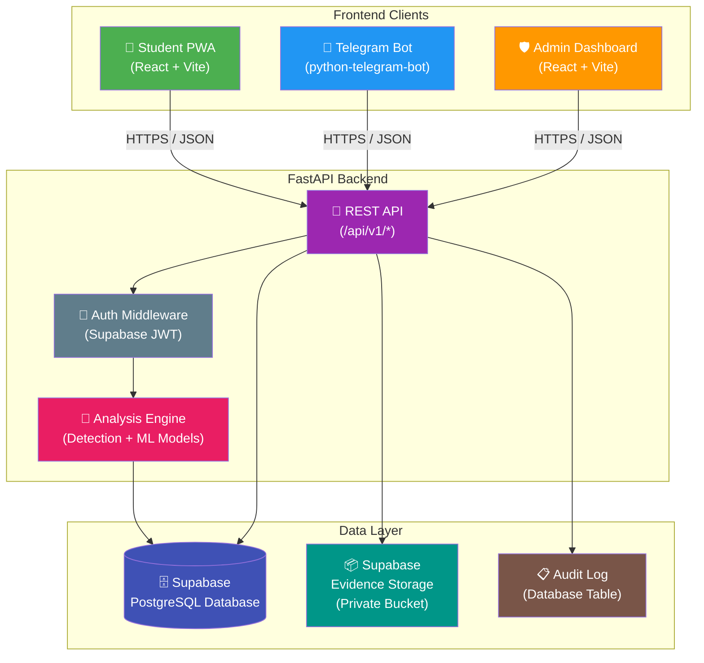
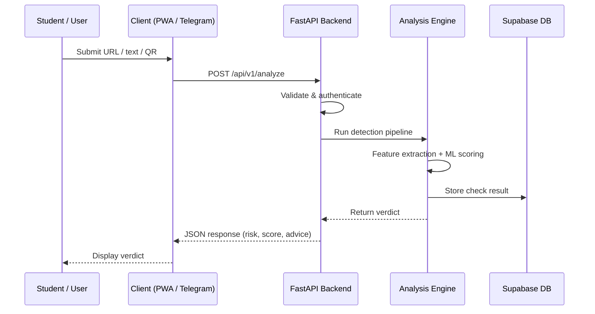

# SignalSafe Campus — System Architecture

> **Document Status:** Phase 0 — Foundation  
> **Last Updated:** 2026-10-30

## Overview

SignalSafe Campus is a multi-client platform for detecting phishing, scam, and social-engineering threats targeting university students. The system follows a **shared-backend architecture**: all frontend clients (PWA, Telegram Bot, Admin Dashboard) communicate through a single FastAPI backend, which owns all detection and analysis logic.

> [!IMPORTANT]
> Detection logic is **never** duplicated in frontend clients. All analysis, risk scoring, and verdict generation happen exclusively in the backend Analysis Engine.

---

## Architecture Diagram

---

## Component Status

| Component | Phase | Status | Description |
|---|---|---|---|
| FastAPI Backend (skeleton) | 0 | ✅ Exists | Health endpoint, project structure |
| Frontend PWA (skeleton) | 0 | ✅ Exists | Vite + React scaffolding |
| Analysis Engine | 1–2 | 🔲 Planned | ML models, URL analysis, text analysis |
| Telegram Bot | 2 | 🔲 Planned | Bot adapter calling shared API |
| Admin Dashboard | 2 | 🔲 Planned | Report management, audit viewer |
| Supabase Database | 1 | 🔲 Planned | Schema, RLS, migrations |
| Evidence Storage | 1–2 | 🔲 Planned | Private Supabase Storage bucket |
| Audit Logging | 2 | 🔲 Planned | Admin action trail |

---

## Architecture Principles

### 1. Single Backend, Multiple Clients

All clients — the student PWA, Telegram bot, and admin dashboard — consume the **same REST API**. This ensures:

- Consistent analysis results regardless of entry point
- Centralized security enforcement
- Simplified maintenance and deployment

### 2. Detection Logic Stays in the Backend

The Analysis Engine is a backend-only component. Frontend clients submit raw input (URLs, text, images) and receive structured verdicts. Clients **never** run detection models or heuristics locally.

### 3. Defense in Depth

Security is layered across the stack:

- **Supabase Auth** issues JWTs validated by the backend
- **Row-Level Security (RLS)** enforces data access at the database level
- **API middleware** handles rate limiting, input validation, and CORS
- **Evidence storage** uses private buckets with signed URLs

### 4. Auditability

All administrative actions (report status changes, domain whitelist edits) are recorded in an immutable audit log, supporting accountability and compliance.

---

## Data Flow

---

## Directory Mapping

| Directory | Component | Owner |
|---|---|---|
| `backend/` | FastAPI Backend + Analysis Engine | All (API); Member A (Engine) |
| `frontend/` | Student PWA | Member B |
| `supabase/` | Database migrations + seed data | Member C |
| `ml/` | ML datasets, notebooks, training | Member A |
| `docs/` | Project documentation | All |

---

## Technology Stack

| Layer | Technology | Purpose |
|---|---|---|
| Backend | Python 3.11+, FastAPI, Uvicorn | REST API server |
| Analysis | scikit-learn, pandas, numpy | ML-based detection |
| Frontend | React 18, Vite, TypeScript | Student PWA |
| Bot | python-telegram-bot | Telegram adapter |
| Database | PostgreSQL (Supabase) | Persistent data store |
| Storage | Supabase Storage | Private evidence files |
| Auth | Supabase Auth (JWT) | Authentication |
| Admin | React 18, Vite, TypeScript | Admin dashboard |

---

## Future Considerations

- **WebSocket support** for real-time admin notifications
- **LLM integration** for natural-language scam analysis (requires `LLM_API_KEY`)
- **Batch analysis** endpoint for bulk URL checking
- **Webhook callbacks** for async analysis results
