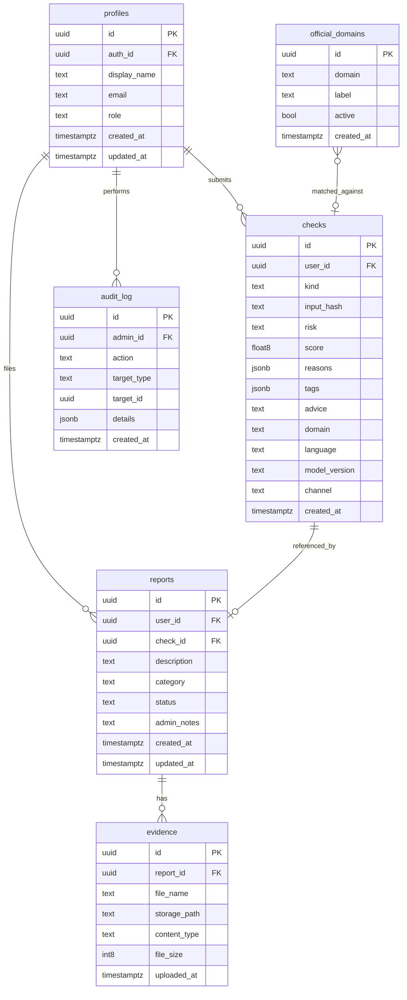

# SignalSafe Campus — Database Schema

> **Document Status:** Phase 0 — Proposed logical schema  
> **Last Updated:** 2026-10-30  
> **Database:** PostgreSQL (via Supabase)

> [!WARNING]
> This document describes the **proposed** database schema. Tables and RLS policies have not yet been created. Production RLS policies will be implemented and tested during the platform module phase.

---

## Entity-Relationship Diagram

---

## Table Definitions

### 1. `profiles`

User profiles linked to Supabase Auth. Created automatically on sign-up via a database trigger.

| Column | Type | Constraints | Description |
|---|---|---|---|
| `id` | `uuid` | `PRIMARY KEY, DEFAULT gen_random_uuid()` | Profile ID |
| `auth_id` | `uuid` | `UNIQUE, NOT NULL, REFERENCES auth.users(id)` | Supabase Auth user ID |
| `display_name` | `text` | `NOT NULL` | User display name |
| `email` | `text` | `NOT NULL` | User email address |
| `role` | `text` | `NOT NULL, DEFAULT 'student'` | Role: `student`, `admin` |
| `created_at` | `timestamptz` | `NOT NULL, DEFAULT now()` | Account creation time |
| `updated_at` | `timestamptz` | `NOT NULL, DEFAULT now()` | Last profile update |

**Indexes:**
- `profiles_auth_id_idx` on `auth_id` (unique)
- `profiles_role_idx` on `role`

**RLS Requirements:**
- Students can read their own profile
- Students can update their own `display_name`
- Admins can read all profiles
- Service role bypasses RLS for backend operations

---

### 2. `checks`

Stores analysis/check results from the detection engine. One row per analysis request.

| Column | Type | Constraints | Description |
|---|---|---|---|
| `id` | `uuid` | `PRIMARY KEY, DEFAULT gen_random_uuid()` | Check ID (returned as `check_id`) |
| `user_id` | `uuid` | `REFERENCES profiles(id)` | Submitting user (nullable for anonymous) |
| `kind` | `text` | `NOT NULL` | Content type: `url`, `text`, `qr` |
| `input_hash` | `text` | `NOT NULL` | SHA-256 hash of input (never store raw input) |
| `risk` | `text` | `NOT NULL` | Verdict: `green`, `amber`, `red` |
| `score` | `double precision` | `NOT NULL` | Confidence score (0.0–1.0) |
| `reasons` | `jsonb` | `NOT NULL, DEFAULT '[]'` | Array of reason strings |
| `tags` | `jsonb` | `NOT NULL, DEFAULT '[]'` | Classification tags |
| `advice` | `text` | | Actionable guidance text |
| `domain` | `text` | | Extracted domain (URL kind) |
| `language` | `text` | `NOT NULL, DEFAULT 'en'` | Language code |
| `model_version` | `text` | `NOT NULL` | Detection model version |
| `channel` | `text` | | Source channel: `pwa`, `telegram`, `admin` |
| `created_at` | `timestamptz` | `NOT NULL, DEFAULT now()` | Analysis timestamp |

**Indexes:**
- `checks_user_id_idx` on `user_id`
- `checks_risk_idx` on `risk`
- `checks_created_at_idx` on `created_at`
- `checks_domain_idx` on `domain`

**RLS Requirements:**
- Users can read their own checks
- Users can insert checks (via backend service role)
- Admins can read all checks
- Backend inserts checks using the service role key

---

### 3. `reports`

Incident reports submitted by users, optionally linked to a prior analysis check.

| Column | Type | Constraints | Description |
|---|---|---|---|
| `id` | `uuid` | `PRIMARY KEY, DEFAULT gen_random_uuid()` | Report ID |
| `user_id` | `uuid` | `NOT NULL, REFERENCES profiles(id)` | Reporting user |
| `check_id` | `uuid` | `REFERENCES checks(id)` | Related check (optional) |
| `description` | `text` | `NOT NULL` | Free-text description |
| `category` | `text` | | Category: `phishing`, `scam`, `impersonation`, `other` |
| `status` | `text` | `NOT NULL, DEFAULT 'pending'` | Status: `pending`, `reviewed`, `resolved`, `dismissed` |
| `admin_notes` | `text` | | Internal admin notes |
| `created_at` | `timestamptz` | `NOT NULL, DEFAULT now()` | Submission time |
| `updated_at` | `timestamptz` | `NOT NULL, DEFAULT now()` | Last status change |

**Indexes:**
- `reports_user_id_idx` on `user_id`
- `reports_status_idx` on `status`
- `reports_created_at_idx` on `created_at`

**RLS Requirements:**
- Users can insert their own reports
- Users can read their own reports (excluding `admin_notes`)
- Admins can read all reports (including `admin_notes`)
- Admins can update `status` and `admin_notes`
- No user can delete reports

---

### 4. `evidence`

Metadata for evidence files attached to reports. Actual files are stored in a **private Supabase Storage bucket**.

| Column | Type | Constraints | Description |
|---|---|---|---|
| `id` | `uuid` | `PRIMARY KEY, DEFAULT gen_random_uuid()` | Evidence record ID |
| `report_id` | `uuid` | `NOT NULL, REFERENCES reports(id) ON DELETE CASCADE` | Parent report |
| `file_name` | `text` | `NOT NULL` | Original file name |
| `storage_path` | `text` | `NOT NULL` | Path within Supabase Storage bucket |
| `content_type` | `text` | `NOT NULL` | MIME type (e.g., `image/png`) |
| `file_size` | `bigint` | `NOT NULL` | File size in bytes |
| `uploaded_at` | `timestamptz` | `NOT NULL, DEFAULT now()` | Upload timestamp |

**Indexes:**
- `evidence_report_id_idx` on `report_id`

**Storage Requirements:**
- Evidence files are stored in a **private** Supabase Storage bucket named `evidence`
- Files are **not publicly accessible**; access requires signed URLs generated by the backend
- File paths follow the pattern: `evidence/{report_id}/{evidence_id}/{file_name}`
- Maximum file size: 10 MB
- Allowed MIME types: `image/png`, `image/jpeg`, `image/webp`, `application/pdf`

**RLS Requirements:**
- Users can insert evidence for their own reports
- Users can read evidence metadata for their own reports
- Admins can read all evidence metadata
- Storage bucket policies mirror database RLS

---

### 5. `audit_log`

Immutable audit trail of administrative actions. Rows are insert-only.

| Column | Type | Constraints | Description |
|---|---|---|---|
| `id` | `uuid` | `PRIMARY KEY, DEFAULT gen_random_uuid()` | Audit entry ID |
| `admin_id` | `uuid` | `NOT NULL, REFERENCES profiles(id)` | Admin who performed the action |
| `action` | `text` | `NOT NULL` | Action type (e.g., `report.status_change`) |
| `target_type` | `text` | `NOT NULL` | Entity type (e.g., `report`, `domain`) |
| `target_id` | `uuid` | | Target entity ID |
| `details` | `jsonb` | `NOT NULL, DEFAULT '{}'` | Action-specific details |
| `created_at` | `timestamptz` | `NOT NULL, DEFAULT now()` | Action timestamp |

**Indexes:**
- `audit_log_admin_id_idx` on `admin_id`
- `audit_log_action_idx` on `action`
- `audit_log_created_at_idx` on `created_at`

**RLS Requirements:**
- Only the backend service role can insert audit entries
- Admins can read all audit entries
- No one can update or delete audit entries (append-only)

**Defined Action Types:**

| Action | Target Type | Details |
|---|---|---|
| `report.status_change` | `report` | `{ "old_status": "...", "new_status": "..." }` |
| `report.notes_added` | `report` | `{ "notes_preview": "..." }` |
| `domain.added` | `domain` | `{ "domain": "..." }` |
| `domain.deactivated` | `domain` | `{ "domain": "..." }` |

---

### 6. `official_domains`

Whitelist of verified official campus domains used by the URL analysis engine.

| Column | Type | Constraints | Description |
|---|---|---|---|
| `id` | `uuid` | `PRIMARY KEY, DEFAULT gen_random_uuid()` | Domain record ID |
| `domain` | `text` | `UNIQUE, NOT NULL` | Domain name (e.g., `university.edu`) |
| `label` | `text` | `NOT NULL` | Human-readable label (e.g., `Main University Site`) |
| `active` | `boolean` | `NOT NULL, DEFAULT true` | Whether domain is currently active |
| `created_at` | `timestamptz` | `NOT NULL, DEFAULT now()` | Record creation time |

**Indexes:**
- `official_domains_domain_idx` on `domain` (unique)
- `official_domains_active_idx` on `active`

**RLS Requirements:**
- All authenticated users can read active domains
- Only admins can insert, update, or deactivate domains
- Domain changes are logged in `audit_log`

---

### 7. `link_codes` *(Optional)*

Short link tracking codes for QR-based campaigns or referral tracking.

| Column | Type | Constraints | Description |
|---|---|---|---|
| `id` | `uuid` | `PRIMARY KEY, DEFAULT gen_random_uuid()` | Link code record ID |
| `code` | `text` | `UNIQUE, NOT NULL` | Short code string |
| `target_url` | `text` | `NOT NULL` | Destination URL |
| `scan_count` | `integer` | `NOT NULL, DEFAULT 0` | Number of scans |
| `active` | `boolean` | `NOT NULL, DEFAULT true` | Whether code is active |
| `created_at` | `timestamptz` | `NOT NULL, DEFAULT now()` | Creation time |
| `expires_at` | `timestamptz` | | Expiration time (optional) |

**Indexes:**
- `link_codes_code_idx` on `code` (unique)

**RLS Requirements:**
- Backend service role manages link codes
- Read-only access for authenticated users

---

## Role Permissions Summary

| Table | Student (Read) | Student (Write) | Admin (Read) | Admin (Write) | Service Role |
|---|---|---|---|---|---|
| `profiles` | Own only | Own `display_name` | All | All | Full |
| `checks` | Own only | — | All | — | Insert |
| `reports` | Own (no notes) | Insert own | All | Update status/notes | Full |
| `evidence` | Own only | Insert for own reports | All | — | Full |
| `audit_log` | — | — | All | — | Insert |
| `official_domains` | Active only | — | All | Insert/update | Full |
| `link_codes` | Read only | — | All | All | Full |

---

## Migration Strategy

- Migrations are stored in `supabase/migrations/` as timestamped SQL files
- Each migration is idempotent and includes both `up` and rollback comments
- The migration order follows table dependencies (profiles → checks → reports → evidence)
- Seed data for development is in `supabase/seed.sql`

> [!IMPORTANT]
> Changes to this database schema require coordination across all team members, as both API responses and frontend clients depend on table structures. See [CONTRIBUTING.md](../CONTRIBUTING.md).
