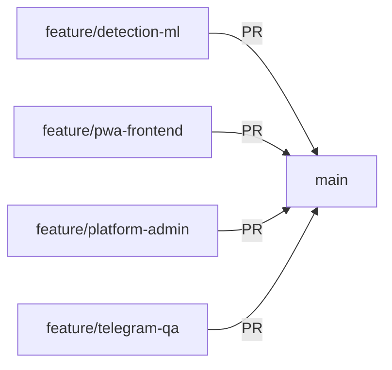
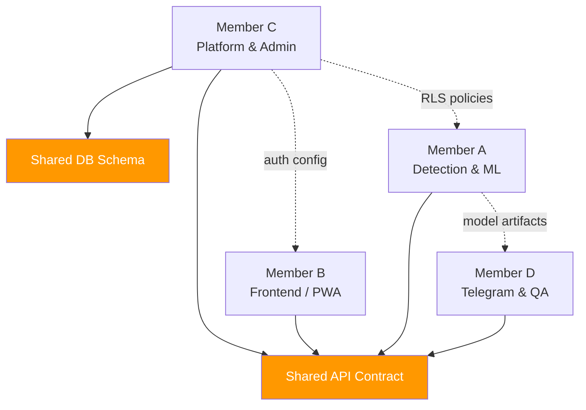

# SignalSafe Campus — Team Assignments

> **Document Status:** Phase 0 — Foundation  
> **Last Updated:** 2026-10-30

---

## Overview

Each team member owns a specific module with a dedicated feature branch. While modules have clear ownership, the project shares common contracts ([API_CONTRACT.md](./API_CONTRACT.md), [DATABASE_SCHEMA.md](./DATABASE_SCHEMA.md)) that require team-wide coordination when modified.

---

## Member A — Detection and ML

**Branch:** `feature/detection-ml`

**Responsibilities:**

| Task | Description |
|---|---|
| Dataset Inspection | Evaluate and clean training datasets for URL and text classification |
| URL Feature Extraction | Build feature engineering pipeline (lexical, host-based, content-based features) |
| Phishing Detection Model | Train and evaluate ML model(s) for URL/text risk classification |
| Explainability | Implement feature importance and human-readable reason generation |
| Risk Assessment | Define scoring logic (green / amber / red) and confidence calibration |

**Key Deliverables:**
- Trained model artifacts in `ml/training/`
- Evaluation metrics and reports in `ml/evaluation/`
- Analysis engine integration in `backend/app/analysis/`
- Feature extraction pipeline with documented features

**Dependencies:**
- Backend API contract for the `/api/v1/analyze` endpoint response shape
- Database schema for the `checks` and `official_domains` tables

---

## Member B — Frontend / PWA

**Branch:** `feature/pwa-frontend`

**Responsibilities:**

| Task | Description |
|---|---|
| Student Interface | Build the main student-facing PWA with React + Vite |
| QR Scanner | Integrate camera-based QR code scanning in the browser |
| Verdict Presentation | Design and implement risk verdict display (green/amber/red) |
| Report Submission | Build the incident report form with evidence upload |
| Responsive Design | Ensure mobile-first responsive layout for campus use |

**Key Deliverables:**
- Complete PWA in `frontend/`
- QR scanning module with camera permissions handling
- Verdict display components (color-coded risk cards)
- Report submission form with file upload
- PWA manifest and service worker for offline capability

**Dependencies:**
- API contract for `POST /api/v1/analyze` and `POST /api/v1/reports`
- Supabase Auth configuration for login/signup flow

---

## Member C — Platform and Admin

**Branch:** `feature/platform-admin`

**Responsibilities:**

| Task | Description |
|---|---|
| Supabase Schema | Implement database migrations matching `DATABASE_SCHEMA.md` |
| Authentication | Configure Supabase Auth (email, OAuth providers) |
| Row-Level Security | Write and test RLS policies for all tables |
| Evidence Storage | Set up private Storage bucket with access policies |
| Audit Log | Implement audit trail for admin actions |
| Admin Dashboard | Build admin UI for report management and audit viewing |

**Key Deliverables:**
- SQL migrations in `supabase/migrations/`
- Tested RLS policies with documented test cases
- Private evidence storage bucket with signed URL generation
- Admin dashboard (separate route or app)
- Audit log query API integration

**Dependencies:**
- Database schema contract (owner of this document)
- API contract for admin endpoints

---

## Member D — Telegram, QA, and Demo

**Branch:** `feature/telegram-qa`

**Responsibilities:**

| Task | Description |
|---|---|
| Telegram Adapter | Build Telegram bot that relays messages to the shared backend API |
| QR Image Decoding | Implement QR code extraction from images sent to the bot |
| Synthetic Testing | Create realistic test scenarios (phishing URLs, scam texts) |
| Integration Testing | Write end-to-end tests covering all client-to-backend flows |
| Demo Documentation | Prepare demo scripts, screenshots, and presentation materials |

**Key Deliverables:**
- Telegram bot in `backend/app/telegram/` or standalone module
- QR decoding from images (using `pyzbar` or similar)
- Test suite with synthetic phishing/scam samples
- Integration test scripts
- Demo walkthrough documentation

**Dependencies:**
- API contract for `POST /api/v1/analyze`
- Backend health endpoint for connectivity testing
- Deployed or running backend instance for integration tests

---

## Coordination Rules

> [!IMPORTANT]
> These rules apply to all team members.

### Shared Contract Changes

The following files are **shared contracts** — they define interfaces between modules:

- [`docs/API_CONTRACT.md`](./API_CONTRACT.md) — API request/response shapes
- [`docs/DATABASE_SCHEMA.md`](./DATABASE_SCHEMA.md) — Table structures and relationships

**Any change to these files must:**

1. Be discussed with **all affected team members** before implementation
2. Be submitted as a **separate PR** (not bundled with feature work)
3. Receive **approval from at least two team members**
4. Update all dependent documentation

### Branch Discipline

- Each member works exclusively on their feature branch
- All merges to `main` go through pull requests
- Feature branches are rebased on `main` regularly to avoid conflicts
- Cross-module work (e.g., backend endpoint needed by frontend) is coordinated via issues

### Communication Expectations

| Situation | Action Required |
|---|---|
| Blocked by another module | Create a GitHub issue and tag the owner |
| Schema or API change needed | Open a discussion before changing shared contracts |
| Breaking change to shared code | Notify all team members before merging |
| Ready for integration testing | Coordinate with Member D |

---

## Module Dependency Graph

